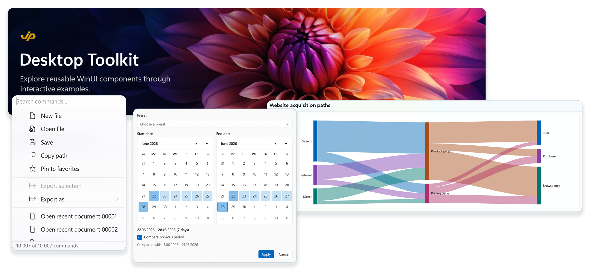

<div align="center">


<h1>JPSoftworks Desktop Toolkit<br/><small>for WinUI</small></h1>

</div>


Build WinUI 3 desktop apps with [interactive charts](#charts), [in-app toast windows](#toast-windows), and [reusable controls and styles](#controls-and-styles). The gallery includes live examples and their source code. The [documentation site](https://desktoptoolkit.jiripolasek.com/) includes the package guides and API reference.

## Component highlights

<div align="center">

</div>

Download the gallery ZIP for your Windows PC (x64 or ARM64) from [GitHub Releases](https://github.com/jiripolasek/DesktopToolkit/releases). Extract the entire ZIP and run `JPSoftworks.DesktopToolkit.Gallery.exe`.

## NuGet packages

| Component guide | NuGet package ID | Version |
| --- | --- | --- |
| [Controls bundle](components/Controls/src/README.md) | `JPSoftworks.DesktopToolkit.Controls` |  |
| [Charts](components/Charts/src/README.md) | `JPSoftworks.DesktopToolkit.Controls.Charts` |  |
| [Toast Windows](components/Toasts/src/README.md) | `JPSoftworks.DesktopToolkit.ToastWindows` |  |
| [Date and Time Controls](components/DateTime/src/README.md) | `JPSoftworks.DesktopToolkit.Controls.DateTime` |  |
| [InfoLabel](components/InfoLabel/src/README.md) | `JPSoftworks.DesktopToolkit.Controls.InfoLabel` |  |
| [Core](components/Core/src/README.md) | `JPSoftworks.DesktopToolkit.Core` |  |
| [KeyVisual](components/KeyVisual/src/README.md) | `JPSoftworks.DesktopToolkit.Controls.KeyVisual` |  |
| [Searchable Flyouts](components/SearchableFlyouts/src/README.md) | `JPSoftworks.DesktopToolkit.Controls.SearchableFlyouts` |  |
| [WinUI Styles](components/Styles/src/README.md) | `JPSoftworks.DesktopToolkit.Styles` |  |

### Controls and styles

The [Controls bundle](components/Controls/src/README.md) installs these five packages together. Charts and Toast Windows install separately.

- **Searchable Flyouts** adds filtering to command menus and dropdowns, including virtualized lists for large item sets.
- **KeyVisual** renders keycaps, presents shortcuts inline, and lets users capture and edit keyboard shortcuts.
- **CalendarDateRangePicker** selects date ranges with presets and customizable flyout content.
- **InfoLabel** adds a native help tooltip beside a field or label.
- **WinUI Styles** provides opt-in styles such as `PillSearchBoxStyle` for a search box with a leading magnifier.

### Charts

Build dashboards and data views with [Charts](components/Charts/src/README.md). Compare series with bar, line, and scatter charts. Show flows and hierarchies with Sankey charts, treemaps, and sunbursts. Monitor changing values with live area graphs, usage meters, and radial gauges.

### Toast Windows

Show save confirmations, status messages, or a report link with [Toast Windows](components/Toasts/src/README.md). These acrylic windows open without taking keyboard focus, dismiss automatically, and can include an action button. They follow the Windows on-screen indicator position by default.

## Installation

For a local preview, [build the packages locally](eng/README.md#build-and-run) and add `artifacts/packages` to your NuGet sources. Keep your regular sources enabled for dependencies.

Run the commands for the packages you want to use from your WinUI app project. The Controls bundle supports .NET 8, .NET 10, and .NET 11 on Windows 10 version 2004 or later. See the package guides above for Charts and Toast Windows requirements.

```powershell
dotnet add package JPSoftworks.DesktopToolkit.Controls --version 0.1.0-preview.2
dotnet add package JPSoftworks.DesktopToolkit.Controls.Charts --version 0.1.0-preview.2
dotnet add package JPSoftworks.DesktopToolkit.ToastWindows --version 0.1.0-preview.2
```

CalendarDateRangePicker, InfoLabel, KeyVisual, and Searchable Flyouts use the same XAML declaration, `xmlns:controls="using:JPSoftworks.DesktopToolkit.Controls"`, even with individual package references. Charts uses `xmlns:charts="using:JPSoftworks.DesktopToolkit.Charts"`. See the [Controls usage example](components/Controls/src/README.md#usage) for a page that uses controls from two packages.

## Localize the controls

Copy the keys you want to translate from a resource template into `Strings/<locale>/` in your app. Use the filename in the table. The same mechanism lets you customize the wording for your app's default language.

| Feature | App resource filename | English template |
| --- | --- | --- |
| Date and Time Controls | `JPSoftworks.DesktopToolkit.DateTime.resw` | [English template](components/DateTime/src/Strings/en-US/JPSoftworks.DesktopToolkit.DateTime.resw) |
| Searchable menus and dropdowns | `JPSoftworks.DesktopToolkit.SearchableFlyouts.resw` | [English template](components/SearchableFlyouts/src/Strings/en-US/JPSoftworks.DesktopToolkit.SearchableFlyouts.resw) |
| Key names and shortcut editor | `JPSoftworks.DesktopToolkit.Keyboard.resw` | [English template](components/KeyVisual/src/Strings/en-US/JPSoftworks.DesktopToolkit.Keyboard.resw) |
| Charts | `JPSoftworks.DesktopToolkit.Charts.resw` | [English template](components/Charts/src/Strings/en-US/JPSoftworks.DesktopToolkit.Charts.resw) |
| Info label | `JPSoftworks.DesktopToolkit.InfoLabel.resw` | [English template](components/InfoLabel/src/Strings/en-US/JPSoftworks.DesktopToolkit.InfoLabel.resw) |

Explicit overrides on a control take precedence. An empty placeholder override hides its hint. Other blank overrides and blank resource entries use the next source. For each key, the toolkit checks the configured custom loader, the app's resource file, the library's resources, and the embedded English catalog in that order. Lookup errors and invalid formats also fall through.
Include an app default-language entry for each translated key to avoid MakePri warning `PRI263`. If your app defaults to English, you can copy the corresponding values from the English templates.
To choose the app's language at startup, set `Microsoft.Windows.Globalization.ApplicationLanguages.PrimaryLanguageOverride` before loading resources or creating controls. After changing the language at runtime, call `ToolkitLocalization.InvalidateStringResources()`. Subsequent lookups use the new language, and existing charts, date range pickers, searchable dropdowns, open searchable flyouts, shortcut keycaps, and shortcut editor previews refresh their built-in text. Explicit text overrides keep their values.

Set `ToolkitLocalization.StringResourceLoader` to an `IStringResourceLoader` to supply strings from another source. Each assignment refreshes cached lookups. Return null for keys that should use the standard RESW lookup. The localized control packages bring in Core automatically.

`DayCountFormat`, `MatchingCommandCountFormat`, and `MatchingChoiceCountFormat` each cover every count. Use wording that works with any number, such as `Days: {0:N0}`.

## Development

See the [development guide](eng/README.md) to run the gallery, build the packages, and work on a component. See the [release guide](eng/RELEASING.md) for CI, NuGet publishing, and the documentation site.

For bug reports and pull requests, see [Contributing](CONTRIBUTING.md). Package changes are listed in the [changelog](CHANGELOG.md).

## License

The Desktop Toolkit is licensed under the [Apache License 2.0](LICENSE). [Third-party notices](NOTICE.md) accompany the relevant source and packages.

## Author

[Jiří Polášek](https://jiripolasek.com)
